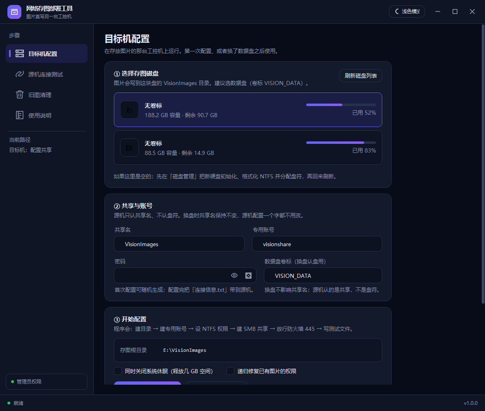
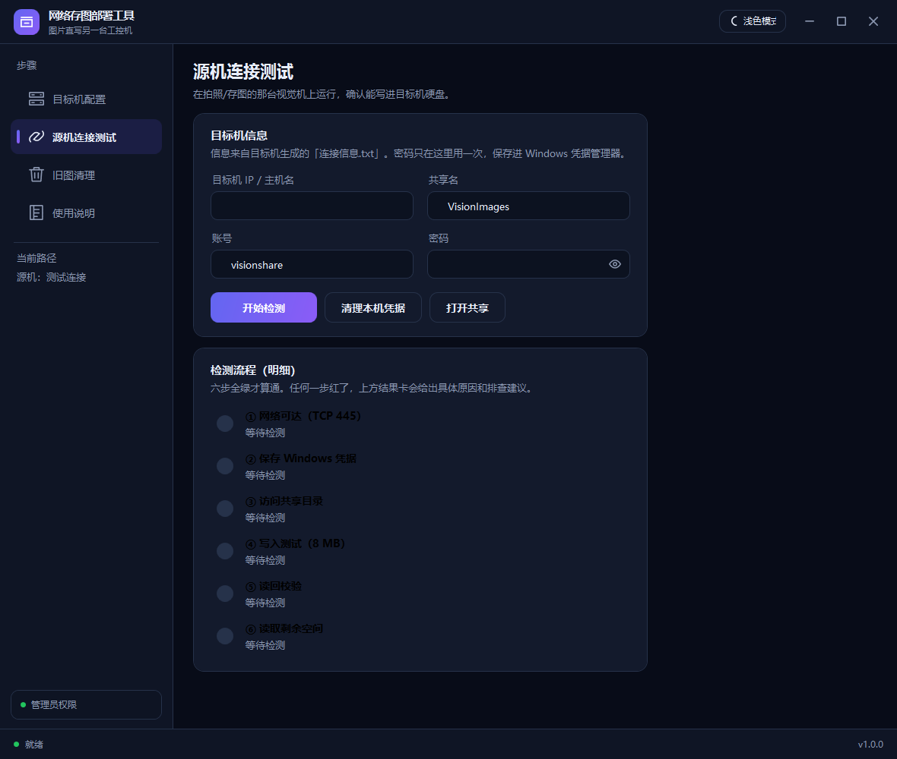
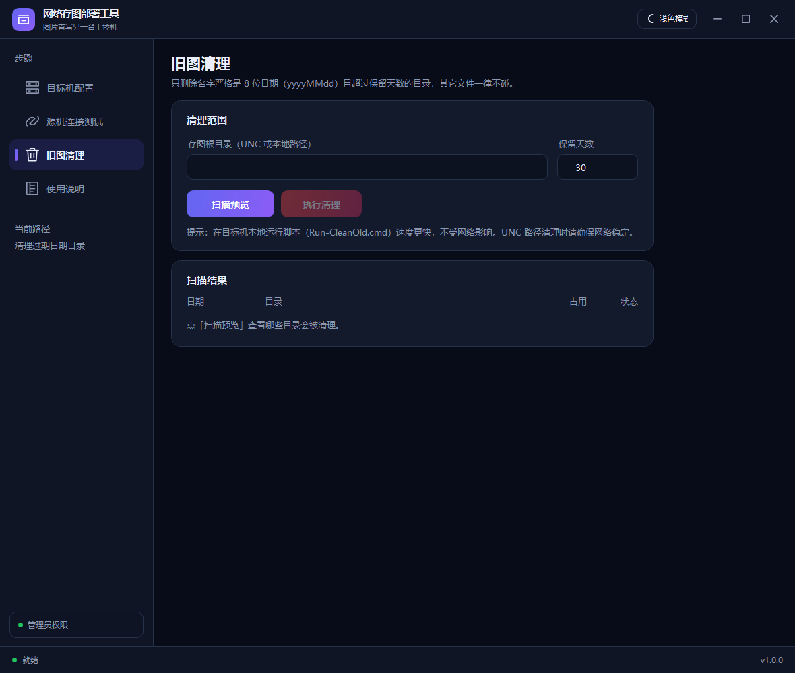
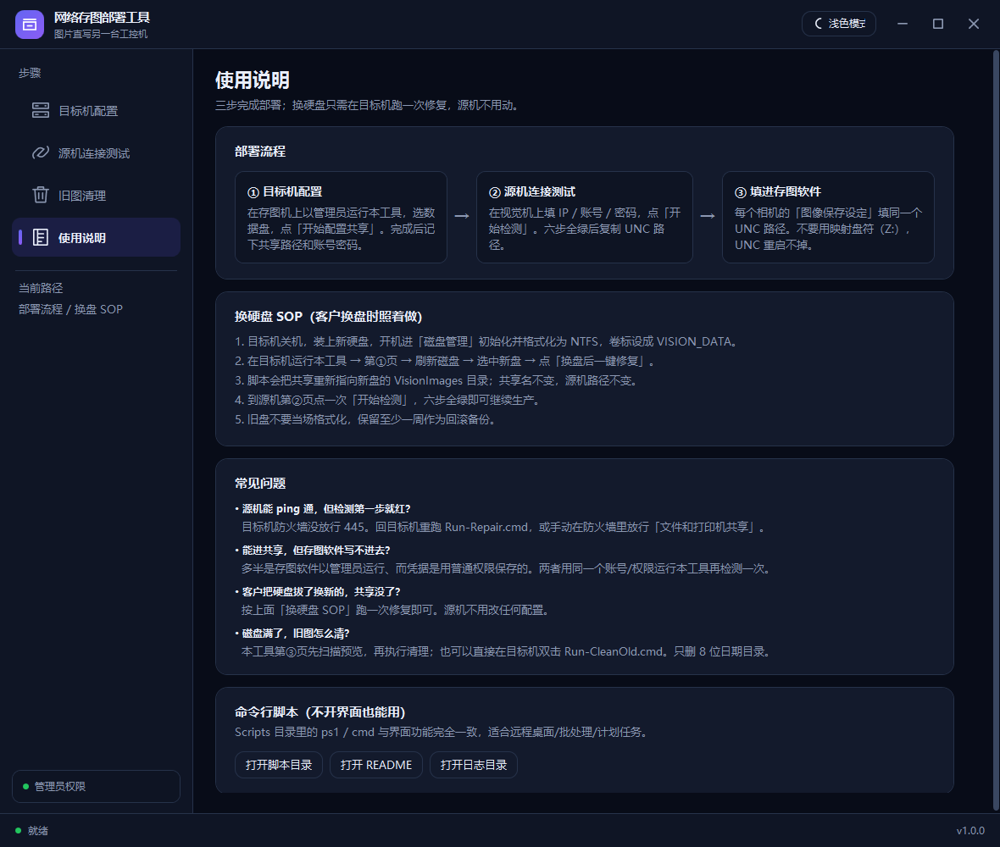
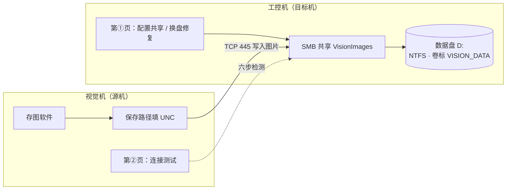

<div align="center">


# 网络存图部署工具

**视觉机拍完图，直接写进另一台工控机的机械硬盘——一个 exe、四个页面，不映射盘符、不装服务。**


图形界面与 PowerShell 脚本共用同一份现场逻辑；三个 ps1 内嵌在 exe 里，现场只拷一个文件也能完成配置、检测和清理。

</div>

---

## 界面速览

| ① 目标机配置 | ② 源机连接测试 |
| --- | --- |
|  |  |
| 选盘 → 建共享/账号/权限/防火墙，勾选即完成 | 六步逐项检测，任何一步失败都给中文原因 |

| ③ 旧图清理 | ④ 使用说明 |
| --- | --- |
|  |  |
| 按 8 位日期目录扫描预览，确认后才删 | 内置部署流程、换盘 SOP 与常见问题 |

---

## 它解决什么问题

现场最怕的四件事，这个工具都包了：

| 现场问题 | 工具做法 |
| --- | --- |
| 不会建共享、不会设权限 | 目标机第①页选盘 → 点「开始配置共享」，目录/账号/NTFS/SMB/防火墙/睡眠一次配好 |
| 不知道源机能不能写进去 | 源机第②页点「开始检测」，六步逐项验证并给出中文失败原因 |
| 客户换硬盘后共享失效 | 目标机第①页点「换盘后一键修复」，盘符/目录/权限/共享自动校正，源机配置不动 |
| 机械盘越用越满 | 第③页按 8 位日期目录扫描预览，确认后再删；也可挂任务计划 |

软件形态：**.NET Framework 4.7.2 + WPF**，单 exe，零第三方依赖，拷到工控机双击即用。

## 两种使用形态

| 形态 | 入口 | 适合 |
| --- | --- | --- |
| 图形界面 | `ImageShareSetup.exe` | 现场实施、客户自助换盘，全程中文提示 |
| 命令行脚本 | `Scripts\*.ps1` + `Run-*.cmd` | 远程桌面、批处理、任务计划、无人值守 |

两者执行的是**同一份脚本**：exe 内嵌了 `Scripts\` 下的三个 ps1，现场只拷 exe 也能干活；
若 exe 同目录存在 `Scripts\`，优先用目录里的版本（临时改脚本验证不用重编译）。

## 架构



- 源机只认 UNC 路径，不映射盘符——换盘、重启、重新登录都不会掉。
- 目标机的配置、修复、清理逻辑同时被 GUI 和命令行复用，不存在两套行为。

---

## 快速开始

### 构建

环境：Visual Studio 2022/2026（含 .NET 桌面开发工作负载）或对应 MSBuild、.NET Framework 4.7.2 Targeting Pack。无需 NuGet 包、无需联网。

```powershell
# 仓库根目录：双击 build.cmd，或在终端执行
.\build.cmd
```

`build.cmd` 会通过 vswhere 自动定位 MSBuild，依次执行 Restore + Build，产物：

```text
bin\Debug\ImageShareSetup.exe     # 单文件，无附带 dll
```

也可以直接在 **Developer Command Prompt for VS** 里构建 Release：

```powershell
msbuild ImageShareSetup.csproj /p:Configuration=Release /p:Platform=AnyCPU /t:Restore
msbuild ImageShareSetup.csproj /p:Configuration=Release /p:Platform=AnyCPU /t:Build
```

> 构建前先关掉正在运行的 exe，否则会报 MSB3027「文件被另一进程锁定」。
> `dotnet build` 也能编，但 WPF + net472 组合以 MSBuild 结果为准。

### 最小运行包

`ImageShareSetup.exe` 一个文件即可运行。建议一起带：

```text
ImageShareSetup.exe
README.md
Scripts\            （可选：保留则现场可直接改脚本/双击 cmd）
```

`Assets\`、`Themes\` 已编进 exe，不用拷。

---

## 首次部署（约 5 分钟）

### 第 1 步：目标机装盘

1. 关机插盘（SATA 不支持热插拔）。
2. 开机进「磁盘管理」：初始化 → 格式化 **NTFS** → 分配盘符（脚本会纠成 `D:`）。
3. 建议卷标改成 `VISION_DATA`。

> `D:` 被光驱/其它盘占用时，先在磁盘管理释放 `D:`，或在脚本参数里改 `-DriveLetter`。

### 第 2 步：目标机配共享

把 `ImageShareSetup.exe` 拷到目标机，右键 → **以管理员身份运行** → 第①页：

1. 选中数据盘；
2. 共享名/账号保持默认；
3. 密码留空（自动生成）；
4. 点「开始配置共享」，等日志出现成功结果；
5. 记下 UNC 路径，密码在 exe 旁边的 `连接信息.txt`（配完请删除；找不到就点第④页「打开日志目录」）。

### 第 3 步：源机测连接

把 exe 拷到视觉机（不需要管理员）→ 第②页填 IP/账号/密码 → 「开始检测」→ 六步全绿。

### 第 4 步：存图软件填路径

1. 打开相机显示窗 → 设置 → **图像/数据保存设定**；
2. 保存路径粘贴 `\\192.168.10.50\VisionImages`（**不要用映射盘符** Z:，UNC 重启不掉）；
3. 确认"路径预览"的 OK/NG 落盘路径；
4. 保存设定；
5. 如果软件按相机分别保存，**每个相机都要填一遍**；
6. 先拍 10 张，到目标机 `D:\VisionImages\日期\相机\OK|NG\` 确认落盘。

> 数据保存路径（Excel 等）同样可以填 UNC。

---

## 四个页面

启动参数 `-Tab 0..3` 可直接打开指定页，例如 `ImageShareSetup.exe -Tab 1`。

### 第①页：目标机配置（在存图机上运行，需管理员）

1. **选择存图磁盘**：列出固定 NTFS 非系统盘（卷标/盘符/容量/占用）。新盘先在「磁盘管理」初始化并格式化 NTFS；**已经是 NTFS、已有盘符的磁盘可直接选，不用格式化（盘里数据不动）**。
2. **共享与账号**：共享名默认 `VisionImages`，账号默认 `visionshare`，密码留空 = 首次自动生成 14 位随机密码、已存在则沿用原密码（不会每次重置）。手工填的密码必须满足本机密码策略，`123456` 这类弱密码会创建账户失败——不确定就留空。
3. **数据盘卷标**：默认 `VISION_DATA`，换盘时按卷标认盘。
4. 可选勾选「同时关闭系统休眠」「递归修复已有图片的权限」。
5. 点 **「开始配置共享」**：建目录 → 建账号 → 设 NTFS → 建共享 → 放行 445 → 关睡眠 → 本地写自检。
6. 成功后卡片列出本机各网卡的 UNC 路径，点「复制共享路径」，**密码看 exe 旁边生成的 `连接信息.txt`**。
7. 换盘后点 **「换盘后一键修复」**：只修盘符/目录/权限/共享，不动账号密码。

> 非管理员启动时页面顶部有提示条和「以管理员身份重启」按钮（会弹 UAC，并记住当前页签）。

### 第②页：源机连接测试（在视觉机上运行）

1. 填目标机 IP / 共享名 / 账号 / 密码（信息来自目标机的 `连接信息.txt`）。
2. 点 **「开始检测」**，六步逐项变绿：

| 步骤 | 检查内容 | 失败常见原因 |
| --- | --- | --- |
| 1 | TCP 445 可达 | 网线/网段/目标机防火墙 |
| 2 | cmdkey 保存凭据 | 账号密码含特殊字符、权限不足 |
| 3 | UNC 共享可访问 | 共享名错、密码错、共享被删 |
| 4 | 写 8MB 并测速 | NTFS 只读、磁盘满、盘只读 |
| 5 | 读回校验 | 网络/硬盘不稳定 |
| 6 | 共享剩余空间 | <50GB 会黄字提醒（不阻断） |

3. 全绿后页面顶部结果卡给出 **存图软件里要填的 UNC 路径**，可一键复制/打开。
4. 换过密码/换过机器时点「清理本机凭据」，避免旧凭据一直生效。
5. 失败时程序会自动删除本次保存的错误凭据，不会污染后续存图软件的访问。

> 凭据保存在**当前 Windows 账号**下。存图软件以管理员运行时，本工具也要以管理员运行，否则凭据不互通。

### 第③页：旧图清理

- 填存图根目录（UNC 或本地）和保留天数，点 **「扫描预览」**。
- 列表显示：日期、目录名、占用、状态（将删除/保留）；只认**严格 8 位数字**的目录名，支持两层结构 `root\20261001` 与 `root\NP-6125\20261001`。
- 确认后点 **「执行清理」**，会二次确认目录清单和总大小；删除中可停止。
- 扫描时记录根目录与天数快照，改完输入框再点执行也不会删错范围。
- 目录名不是 8 位日期的文件/目录一律不动。

> 在目标机本地跑（`Run-CleanOld.cmd`）比走 UNC 快，且不受网络波动影响。建议挂任务计划每天凌晨执行。

### 第④页：使用说明

内置部署流程、换盘 SOP、常见问题；三个按钮可打开脚本目录、README、日志/临时目录。

### 本地设置与主题

- 右上角切换深/浅主题，立即生效。
- 正常关闭窗口时写入 `%APPDATA%\ImageShareSetup\ui.ini`（主题、IP、共享名、账号、清理路径/天数）；强制杀进程不会保存。
- 密码永远不落本地设置文件。

---

## 换盘 SOP（客户把机械盘拔走换新盘）

### 换盘前

1. 存图软件暂停保存（或直接关软件）；
2. 等目标机当前写入完成（资源管理器看目录时间戳不再变化）；
3. 关机换盘（SATA 不要带电插拔；USB 硬盘盒先"安全删除硬件"）。

### 换盘后

1. 新盘初始化 + 格式化 NTFS + 卷标改 `VISION_DATA`；
2. 目标机打开本工具（管理员）→ 第①页 → **「换盘后一键修复」**；
3. 脚本自动：按卷标找盘 → 纠盘符 `D:` → 建目录 → 重设权限 → 校正共享 → 写自检；
4. **源机不需要改任何配置**（IP/共享名/账号都没变）；
5. 存图软件恢复保存，拍两张确认。

> 新盘是从别的机器拿来的、旧文件权限对不上时，加 `-RecursiveAcl` 递归重设：
> `powershell -ExecutionPolicy Bypass -File .\Scripts\Setup-ImageShare.ps1 -Repair -RecursiveAcl`
> （文件多会很慢，首次配置新盘不需要）

### 五个不要动的固定点

- 目标机 **IP 固定**（静态 IP 或路由器 DHCP 保留）；
- 共享名固定 `VisionImages`；
- 数据盘盘符固定 `D:`（脚本自动纠）；
- 数据盘卷标统一 `VISION_DATA`（换盘按卷标认盘）；
- 账户固定 `visionshare`，密码只在首次配置时生成一次。

---

## 上线前必读：UNC 直写的三个坑

UNC 直写本身可用（Windows 文件 API、`FileInfo`、`Directory.CreateDirectory`、各视觉库的存图工具都支持 UNC），但现场要提前知道三件事：

1. **断网/目标机断电时写盘会等超时**：SMB 写超时默认约 60 秒，存图线程可能被卡住、队列积压；如果存图软件是单线程串行写盘，关软件也可能要等线程退出。
   → 换盘/维护前先停存图或关软件；网络不稳定的现场建议先给存图软件加"本地暂存 + 自动补传"再上线。
2. **按盘符统计剩余空间的清理逻辑在 UNC 下可能失效**：`DriveInfo` 之类 API 对 UNC 取不到真实容量，可能返回超大值，导致"空间充足"永远成立、按天数清理不执行，机械盘会一直涨到满。
   → 用本工具第③页按日期清理，并挂任务计划定期跑。
3. **扫描 UNC 目录在断网时会等系统超时**：资源管理器、存图浏览页、缩略图列表都可能卡住。
   → 网络断开时不要浏览共享目录；维护窗口内先停掉存图软件对该路径的访问。

> 具体表现取决于存图软件的存图线程模型和清理实现，本工具只能绕开，不能替它根治。

---

## 脚本参数速查

### Setup-ImageShare.ps1（目标机，需管理员）

| 参数 | 默认 | 说明 |
| --- | --- | --- |
| `-ShareName` | `VisionImages` | SMB 共享名 |
| `-VolumeLabel` | `VISION_DATA` | 数据盘卷标（换盘认盘用） |
| `-DriveLetter` | `D` | 数据盘固定盘符 |
| `-FolderName` | `VisionImages` | 存图根目录名 |
| `-User` | `visionshare` | 专用本地账户 |
| `-Password` | 空=随机生成/沿用 | 账户密码 |
| `-DataDrive` | 空=自动找 | 直接指定存图盘当前盘符（界面走这个） |
| `-BindIp` | 空=列出全部 | 指定写进连接信息的本机 IP |
| `-Repair` | 关 | 换盘修复模式（不动账号/防火墙/电源） |
| `-RecursiveAcl` | 关 | 递归重设已有文件权限（慢） |
| `-DisableHibernate` | 关 | 同时关闭系统休眠 |

### Connect-ImageShare.ps1（源机）

| 参数 | 默认 | 说明 |
| --- | --- | --- |
| `-Server` | 交互输入 | 目标机 IP/主机名，也接受完整 UNC |
| `-Share` | `VisionImages` | 共享名 |
| `-User` | `visionshare` | 账户 |
| `-Password` | 交互输入 | 密码（不回显） |
| `-SizeMB` | `8` | 写入测速文件大小 |

### Clear-OldImages.ps1（目标机/源机均可）

| 参数 | 默认 | 说明 |
| --- | --- | --- |
| `-Root` | 必填 | 存图根目录（UNC 或本地） |
| `-Days` | `30` | 保留天数 |
| `-Execute` | 关 | 不加=只预览；加了才真删 |

---

## 常见问题

| 现象 | 原因 | 处理 |
| --- | --- | --- |
| 第②页第一步就红（连不上 445） | 网络不通 / 防火墙没放行 / Server 服务停了 | 先 `ping`；目标机防火墙放行 445；`services.msc` 看 `LanmanServer` 是否运行 |
| 能连端口但进不去共享 | 共享名错、账号密码错、共享被删 | 目标机重跑「换盘后一键修复」；源机重新检测；资源管理器直接输 UNC 验证 |
| 能进共享但存图软件写不进去 | 凭据不在同一账号下 / NTFS 只给读 / 盘满 | 本工具与存图软件用相同权限运行后重测；目标机 Repair；看第②页剩余空间 |
| 换盘后路径打不开 | 新盘盘符不是 `D:` / 共享指向旧路径 | 目标机点「换盘后一键修复」 |
| 重启后又要输密码 | 没用 cmdkey（手工映射盘） | 源机第②页重新检测保存凭据 |
| 提示"不允许空密码" | 账户密码为空 | 目标机 `Setup-ImageShare.ps1 -Password 新密码` 重设 |
| 目标机睡眠后掉线 | 电源计划休眠 | 第①页勾「关闭系统休眠」重跑一次，或手动改电源计划 |
| 速度只有几 MB/s | 百兆网络/网线劣质/机械盘忙 | 第②页看测速；换千兆交换机/网线，或降低图片格式 |
| 扫描结果没列出某个日期目录 | 目录名不是严格 8 位数字（如 `2026-10-01`） | 改名成 `20261001`；工具只认 `yyyyMMdd` |
| exe 双击闪退 | 缺 .NET Framework 4.7.2 / 异常 | 看 `%TEMP%\ImageShareSetup.crash.txt` |

---

## 安全与回滚

- 专用账户 `visionshare` 只给 `VisionImages` 目录的"修改"权限，不是管理员。
- 共享权限给 `visionshare` 完全控制（SMB 层），NTFS 只给修改，最终有效权限 = 修改。
- `连接信息.txt` 含明文密码，**配置完成后请删除**；工具本身不存密码。
- 回滚（不再用网络存图）：

```powershell
# 目标机管理员执行
net share VisionImages /delete /y
net user visionshare /delete
Remove-NetFirewallRule -DisplayName "ImageShare-SMB445"
```

然后把存图软件各相机的保存路径改回本地盘；数据目录按需保留。

---

## 目录结构

```text
ImageShareSetup/
├─ ImageShareSetup.csproj       WPF 工程（net472 / UseWPF / 单 exe）
├─ App.xaml / App.xaml.cs       程序入口，-Tab N 启动参数，崩溃兜底
├─ MainWindow.xaml(.cs)         四页界面与全部业务逻辑
├─ app.manifest                 UAC 清单（asInvoker，需要时由界面主动提权）
├─ build.cmd                    一键构建（自动定位 MSBuild）
├─ Assets/
│  ├─ app.ico                   多尺寸图标：exe / 快捷方式 / 窗口 / 任务栏
│  └─ app.png                   800×800 原图（品牌展示用）
├─ Themes/
│  ├─ Dark.xaml / Light.xaml    深浅主题色板（键名一一对应）
│  └─ Controls.xaml             galaxy 风格控件样式（按钮/输入/列表/进度条）
├─ Core/
│  ├─ EmbeddedScripts.cs        内嵌脚本释放（优先用 exe 同级 Scripts/）
│  ├─ ScriptRunner.cs           PowerShell 流式执行（UTF-8、双流读取、可取消）
│  ├─ ConnectTester.cs          六步连接检测（TCP/cmdkey/UNC/写读测速/剩余空间）
│  └─ DiskScanner.cs            固定 NTFS 非系统盘扫描
├─ ThemeManager.cs              运行时换肤
├─ UiSettings.cs                本地设置（%APPDATA%\ImageShareSetup\ui.ini）
├─ CleanItem.cs                 清理列表行模型
├─ Scripts/                     现场脚本（GUI 与命令行共用）
│  ├─ Setup-ImageShare.ps1      目标机配置 / 换盘修复
│  ├─ Connect-ImageShare.ps1    源机命令行连接测试
│  ├─ Clear-OldImages.ps1       按日期清理旧图（默认只预览）
│  └─ Run-*.cmd                 四个双击入口（自动提权/交互输入）
├─ docs/images/                 README 界面截图
└─ README.md                    本文件
```

运行期文件（不参与编译）：

- `%APPDATA%\ImageShareSetup\ui.ini`：主题 + 上次填写的目标机信息，**不存密码**；删掉即恢复默认。
- `%TEMP%\ImageShareSetup\scripts\<版本>\`：exe 内嵌脚本的释放目录（exe 同级没有 `Scripts\` 时使用）。
- `%TEMP%\ImageShareSetup.crash.txt`：未处理异常堆栈（正常运行时不存在）。

## 图标规范（换图标只看这一节）

| 文件 | 作用 | 工程里的接线 |
| --- | --- | --- |
| `Assets\app.ico` | exe 图标（资源管理器/快捷方式）+ 窗口图标（标题栏/任务栏/Alt+Tab） | csproj `<ApplicationIcon>` + `MainWindow.xaml` 的 `Icon="pack://application:,,,/Assets/app.ico"` |
| `Assets\app.png` | 800×800 原图，界面品牌位/以后做关于页 | csproj `<Resource>` |

- `app.ico` 必须是**多尺寸**（当前 16/24/32/48/64/128/256），只放 256 单尺寸时任务栏小图标会糊。
- 快捷方式图标不需要单独设置：右键 exe → 发送到 → 桌面快捷方式，自动继承 exe 图标。
- 换图标流程：替换 `Assets\app.png`（正方 PNG）→ 重新生成多尺寸 ico（覆盖 `Assets\app.ico`）→ 重新编译。
- 工程已把 `Assets\app.ico` 声明为 `<Resource>`，改完路径不用动 XAML。
